# Assignment 5 — Deploy EpicBook Web App on Azure VM with Azure Database for MySQL

Part of the DevOps Micro Internship (DMI) with Agentic AI

---

## Purpose

In this assignment, you will deploy the EpicBook web application on Azure using an Ubuntu Virtual Machine to host the frontend and backend, and Azure Database for MySQL Flexible Server (private access) to store user and product data. You will build the network, provision the resources, deploy the application, and prove that the complete user flow works through the VM's public IP.

---

# Task 1 — Create Network Infrastructure

## Goal

Create a Resource Group and VNet (`10.0.0.0/16`) with `public-subnet` (`10.0.1.0/24`) for the VM and a delegated `private-db-subnet` (`10.0.2.0/24`) for MySQL. Configure and associate the public and private NSGs with the required HTTP, SSH, and MySQL rules.

## Evidence

#### Screenshot 1 — Virtual Network configuration showing the `10.0.0.0/16` address space and both subnets

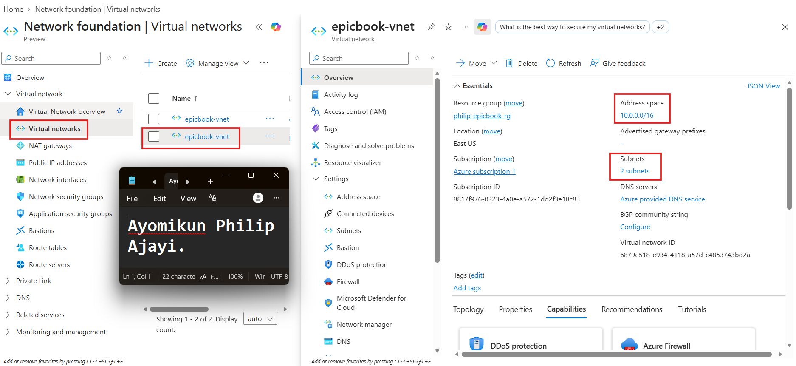

---

#### Screenshot 2 — Public and private NSG inbound rules showing ports 80, 22, and restricted 3306 access

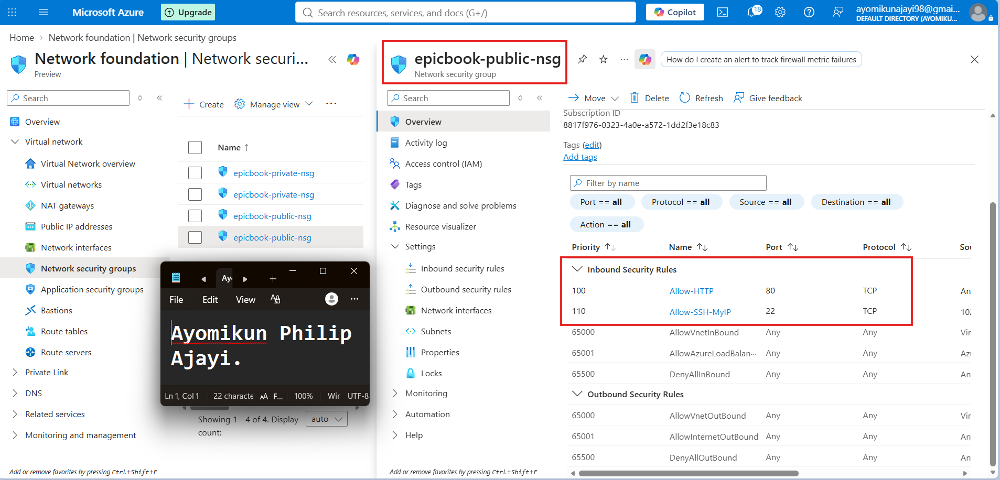  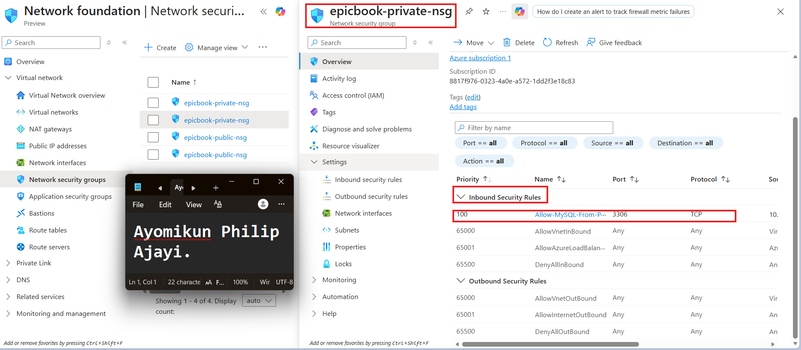

---

#### Screenshot 3 — Public IP and Network Interface association for the Virtual Machine

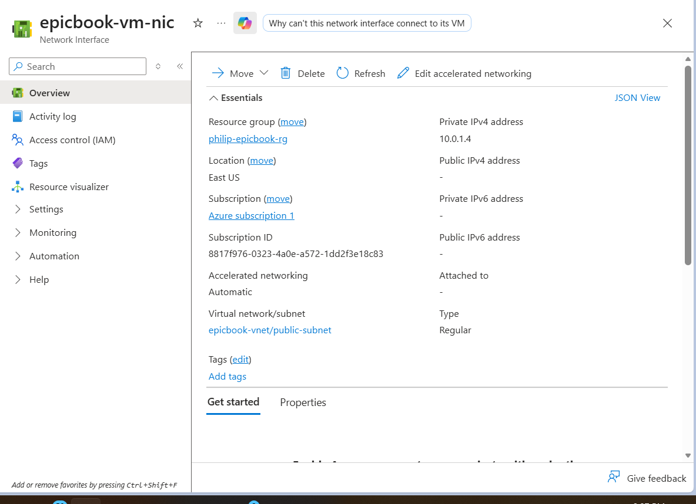

---

# Task 2 — Provision Azure Virtual Machine

## Goal

Launch an Ubuntu 22.04 LTS VM (Standard B1s or equivalent) in the public subnet, and install Node.js, npm, Nginx, Git, and MySQL Client.

### Evidence

#### Screenshot 4 — Virtual Machine overview showing Ubuntu, size, public IP, and subnet

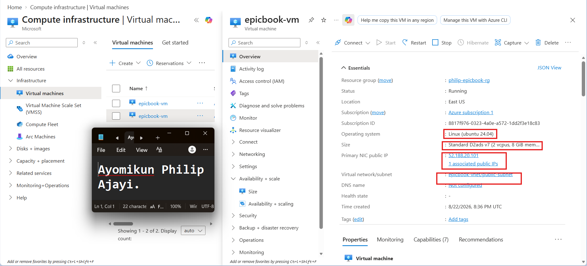

---

#### Screenshot 5 — Terminal showing successful software installation or installed-version checks

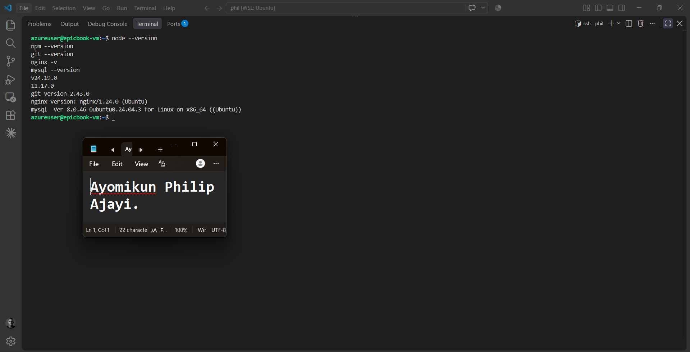

---

# Task 3 — Configure Azure Database for MySQL and Prepare the EpicBook Database

## Goal

Create Azure Database for MySQL Flexible Server using Private access (VNet Integration) in the delegated database subnet. Clone the EpicBook repository to the VM, create `bookstore`, import the schema and seed data, and verify the database contents.

## Evidence

#### Screenshot 6 — MySQL Flexible Server overview showing the server running and configured with private access

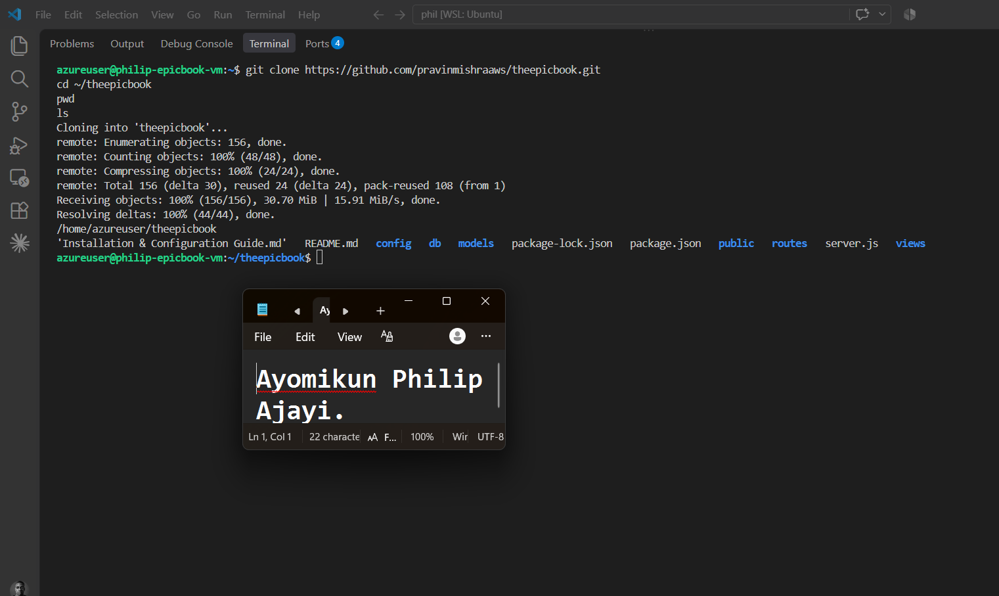

---

#### Screenshot 7 — MySQL networking configuration showing the server connected to the private database subnet

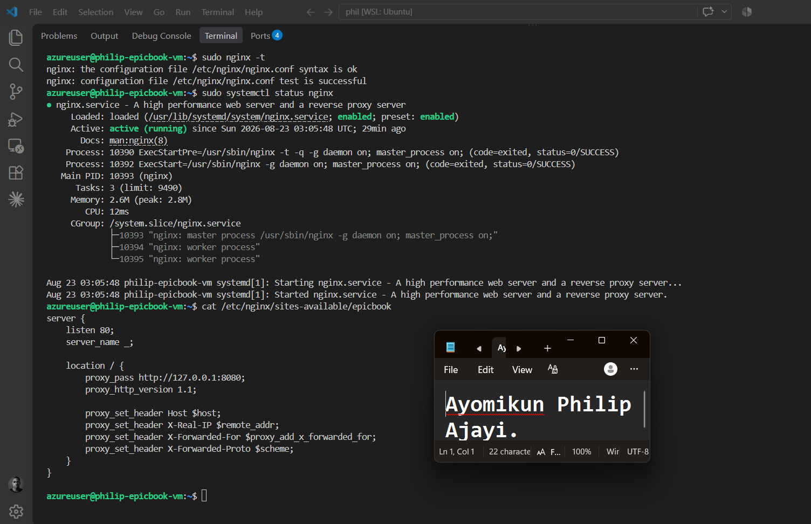

---

#### Screenshot 8 — VM terminal showing the `bookstore` database tables and seeded author and book records

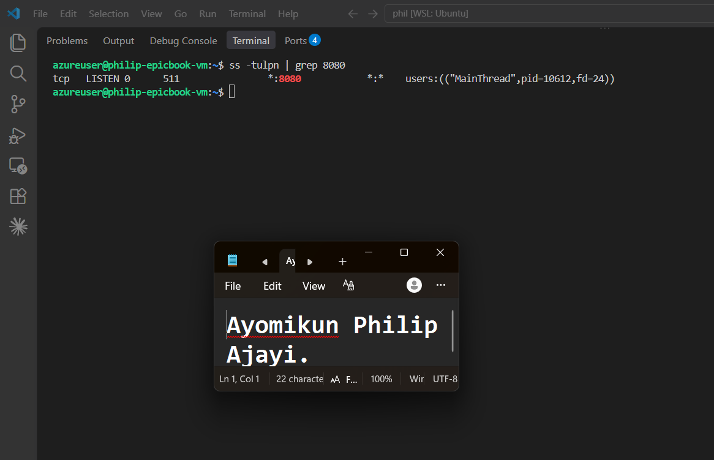

---

# Task 4 — Deploy and Configure the EpicBook Application

## Goal

Install the EpicBook dependencies, configure `config/config.json` with the Azure MySQL connection details, and configure Nginx to proxy HTTP traffic from port 80 to the Node.js application on port 8080.

## Evidence

#### Screenshot 9 — Terminal showing the EpicBook repository, successful dependency installation, and the `node_modules` folder

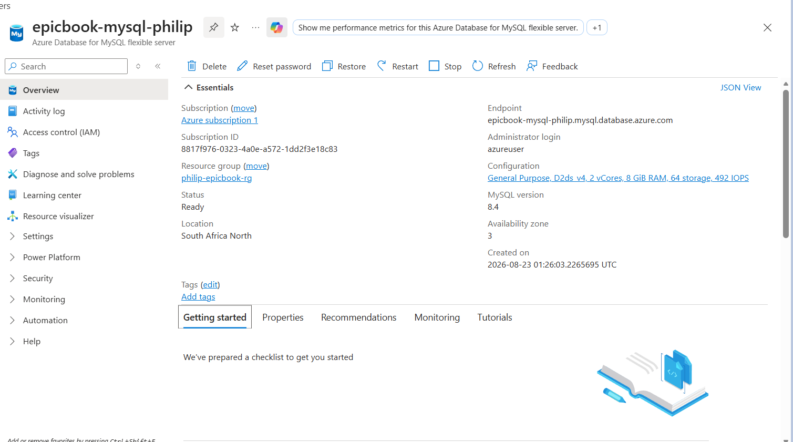

---

#### Screenshot 10 — EpicBook Nginx configuration showing `proxy_pass http://127.0.0.1:8080`, or successful `sudo nginx -t` output and active Nginx service status

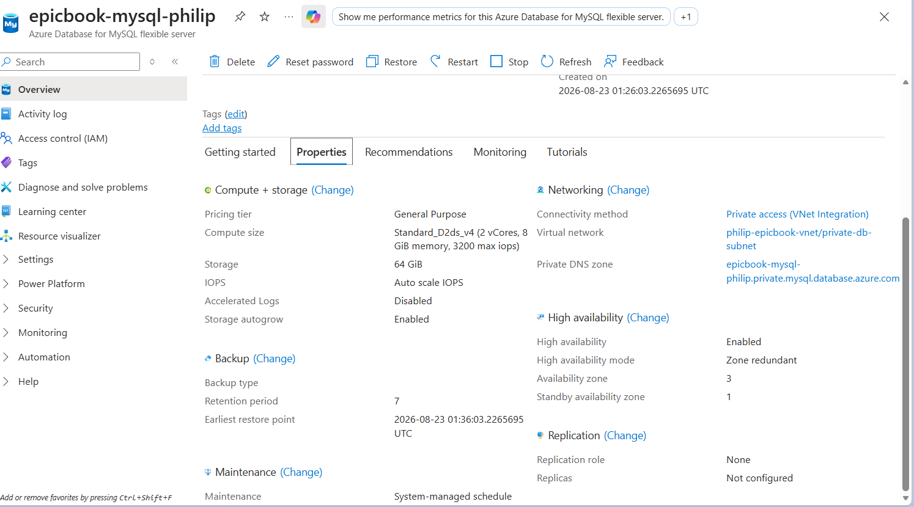

---

#### Screenshot 11 — Terminal showing the EpicBook application running and listening on port 8080

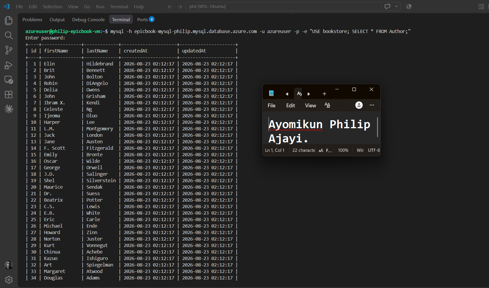

---

# Task 5 — Test End-to-End Functionality

## Goal

Verify that EpicBook loads through the VM’s public IP, displays products, supports cart operations and checkout, and records the corresponding changes in Azure Database for MySQL.

## Evidence

#### Screenshot 12 — Browser showing the EpicBook application with the Virtual Machine public IP visible

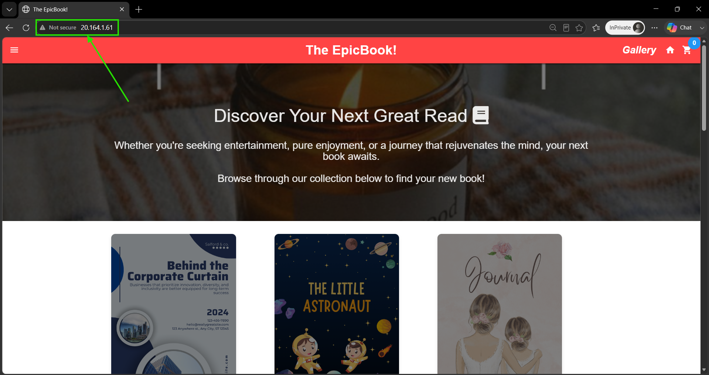

---

#### Screenshot 13 — Proof of a successful cart or order action together with the corresponding database verification

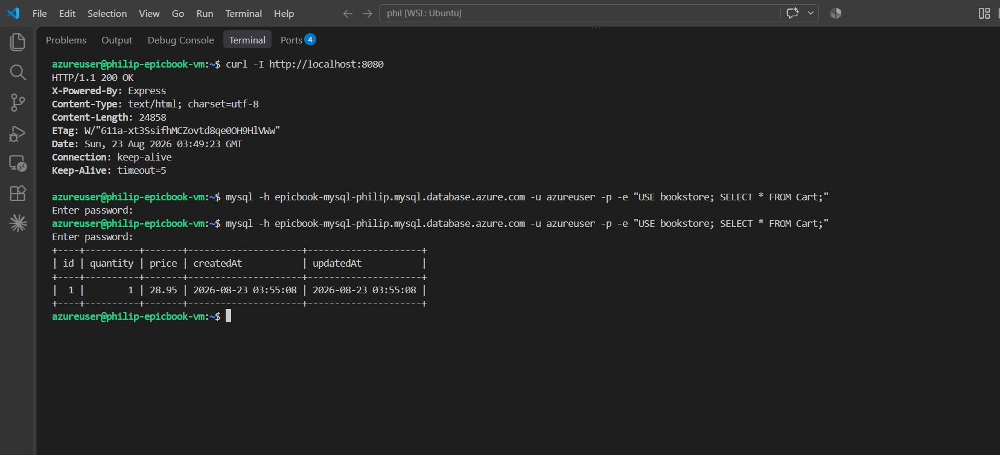

---

#### Public IP URL

Paste the public IP URL of your Virtual Machine here:

`http://20.164.1.61`

---

# Submission Instructions

- Include your full name and Screenshots **1–15** under the corresponding evidence headings.
- Include the working **Virtual Machine public IP URL** and published **LinkedIn post URL**.
- Add brief notes describing your network, VM, application, and database configuration.
- Include proof of product viewing, cart operations, and order placement.
- Ensure screenshots are readable and show your own environment.
- Do not expose database passwords, private keys, connection strings containing credentials, subscription IDs, or other sensitive information.
- Submit your work using the method specified in the assignment guidelines.

---

# Completion Checklist

- [ ] Task 1: Resource Group, VNet, subnets, and NSGs created (Screenshots 1–2)
- [ ] Task 2: VM deployed with NIC and Public IP, and required software installed (Screenshots 3–5)
- [ ] Task 3: Private MySQL server configured, `bookstore` created, and schema and seed data imported (Screenshots 6–8)
- [ ] Task 4: EpicBook configured and running behind Nginx (Screenshots 9–11)
- [ ] Task 5: Product viewing, cart operations, checkout, and database changes verified (Screenshots 12–13)
- [ ] PM2 configured, startup command completed, and process list saved (Screenshot 14)
- [ ] Application remains accessible through Nginx while running under PM2
- [ ] LinkedIn post published with the required hashtags, credit note, and tags (Screenshot 15)
- [ ] Full name, working website URL, and LinkedIn post URL included
- [ ] Brief configuration notes included
- [ ] All screenshots readable and no sensitive information exposed

---

## 📌 About DMI & CloudAdvisory

DevOps Micro Internship (DMI) is a project-based DevOps program run by Pravin Mishra (The CloudAdvisory) focused on real-world execution, systems thinking, and career readiness.

It helps learners build strong DevOps foundations with hands-on experience.

---

## 📌 Resources

- 🌐 DMI Official Website: https://dmi.pravinmishra.com?utm_source=github&utm_medium=readme  
- 🎓 University: https://university.pravinmishra.com?utm_source=github&utm_medium=readme  
- 💬 Discord Community: https://discord.pravinmishra.com?utm_source=github&utm_medium=readme  
- 📝 Blog: https://dmi.pravinmishra.com/blog?utm_source=github&utm_medium=readme  
- ▶️ YouTube Playlist: https://www.youtube.com/playlist?list=PLFeSNDtI4Cho  
- 🔗 Pravin Mishra (LinkedIn): https://www.linkedin.com/in/pravin-mishra-aws-trainer/  
- 🏢 CloudAdvisory (LinkedIn): https://www.linkedin.com/company/thecloudadvisory/

---

*This submission is part of DevOps Micro Internship (DMI) — Agentic AI Track.*
