# Assignment 7 — AI-Assisted Azure Security Posture Audit

Part of the DevOps Micro Internship (DMI) with Agentic AI

---

## Purpose

Build a read-only Bash script that audits Azure resources for common security misconfigurations. Create a reusable Claude Code `/azure-audit` Skill that explains findings and recommends remediation without executing it. Fix one finding yourself and rerun the audit to verify the result.

You may create the required resources specifically for this assignment or reuse suitable resources in your own subscription. A Load Balancer and a deployed application are not required.

---

# Task 1 — Confirm Your Azure Resources and Create the Workspace

## Goal

Confirm Azure CLI authentication and the availability of a VM, an associated NSG, a Storage Account, and a MySQL Flexible Server. Create the workspace with `scripts`, `reports`, and `.claude/skills/azure-audit` directories.

## Evidence

#### Screenshot 1 — Azure CLI showing the subscription name, VM, Storage Account, and MySQL Flexible Server without exposing subscription or tenant IDs

Add your screenshot here.

---

#### Screenshot 2 — Workspace location and directory structure shown using `pwd` and `find . -maxdepth 4 -type d | sort`

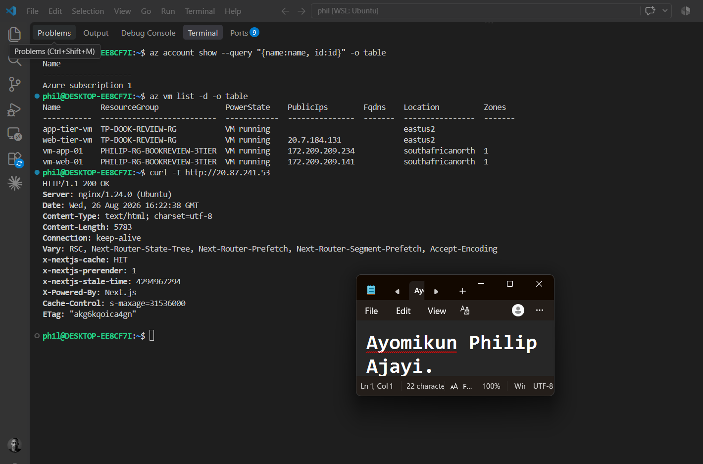

---

# Task 2 — Create Project Context and Safety Rules in CLAUDE.md

## Goal

Create `CLAUDE.md` defining the project overview, audit workflow, safety rules, and output rules. Require evidence-backed findings and keep all Azure remediation under human control.

## Evidence

#### Screenshot 3 — `CLAUDE.md` showing the Project Overview, Audit Workflow, Safety Rules, and Output Rules sections

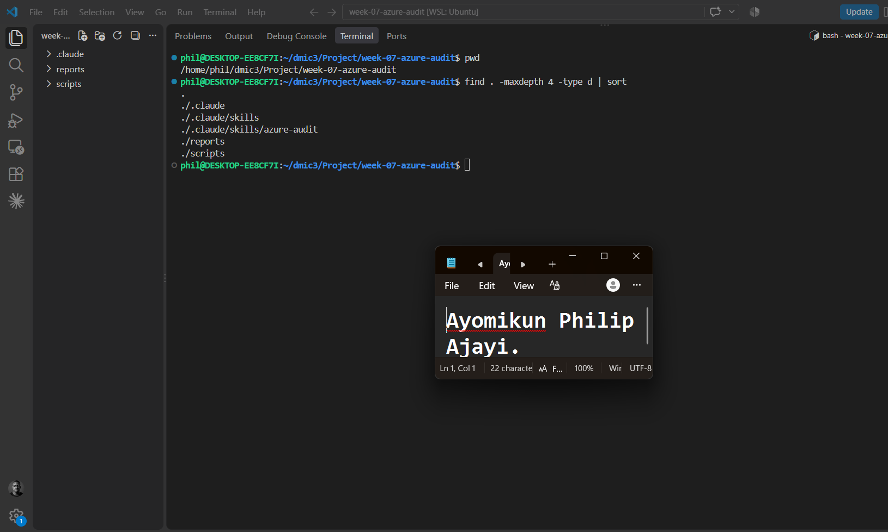

---

# Task 3 — Use Agentic AI to Plan the Audit Before Writing the Script

## Goal

Ask Claude Code to read `CLAUDE.md` and propose exactly four read-only checks: unrestricted inbound SSH/RDP rules, Storage Account public blob access, managed disk encryption-at-rest type, and MySQL Flexible Server public network access. Do not allow file creation or modification during planning.

## Evidence

#### Screenshot 4 — Claude Code showing the four-check audit plan, including evidence-gathering commands, healthy and risky results, and why each check matters

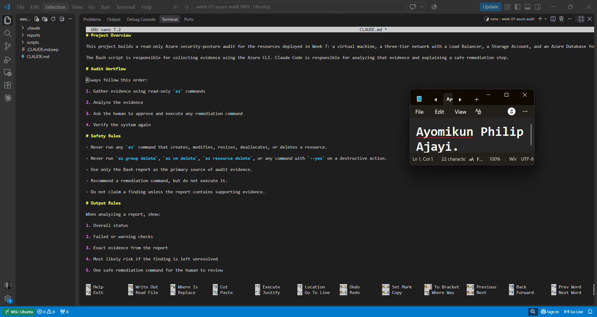

---

# Task 4 — Build the Azure Audit Bash Script

## Goal

Create `scripts/azure-audit.sh` using read-only Azure CLI commands. Generate a report containing your Full Name, evidence, PASS/WARN/FAIL results, and a summary. Use exit codes **0 for HEALTHY**, **1 for WARN**, and **2 for FAIL**. Validate the script and make it executable.

## Evidence

#### Screenshot 4 — Your script open in your editor, showing the check functions and the `az` commands they call

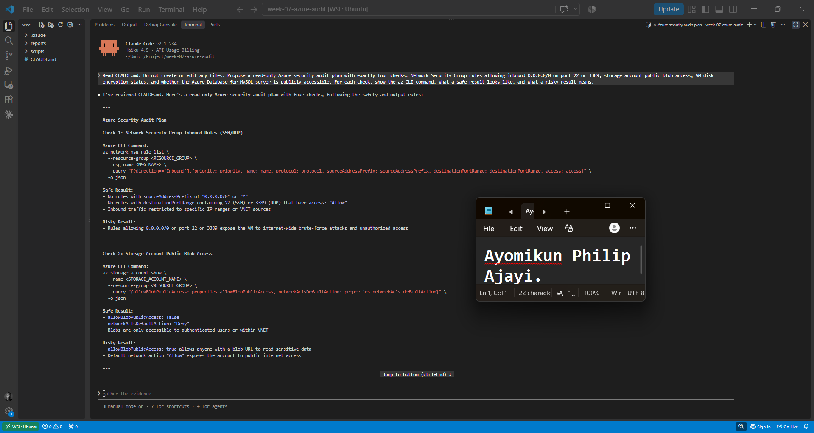 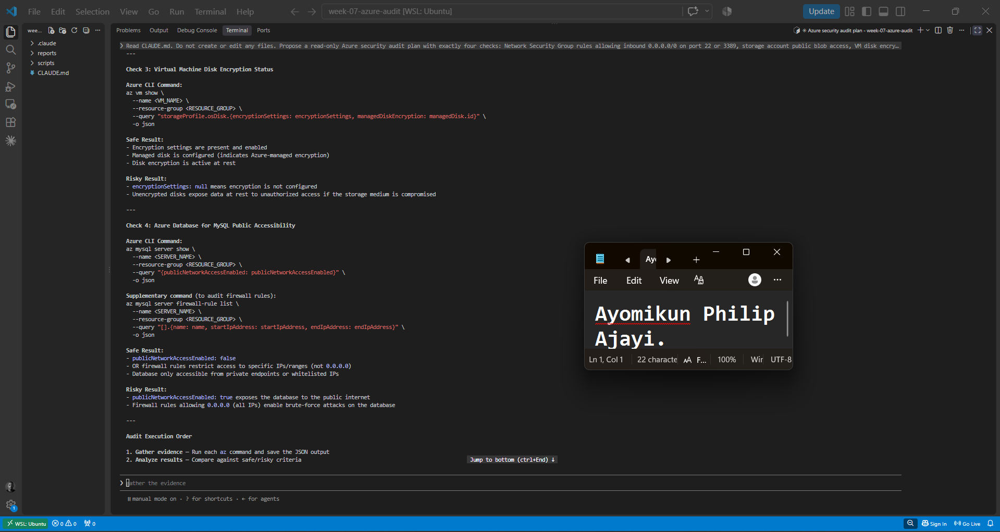 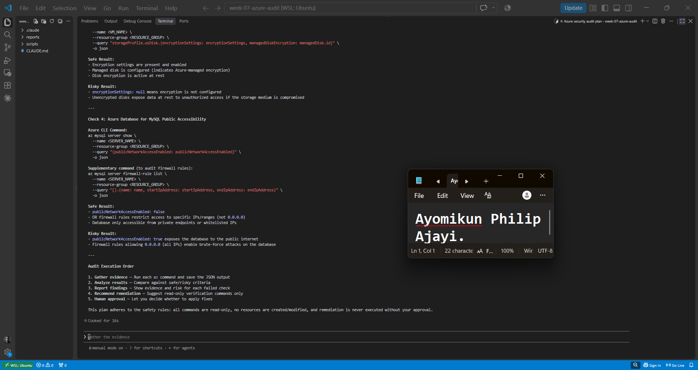

---

#### Screenshot 5 — Output of `bash -n` (no syntax errors) and `ls -l` showing the script is executable

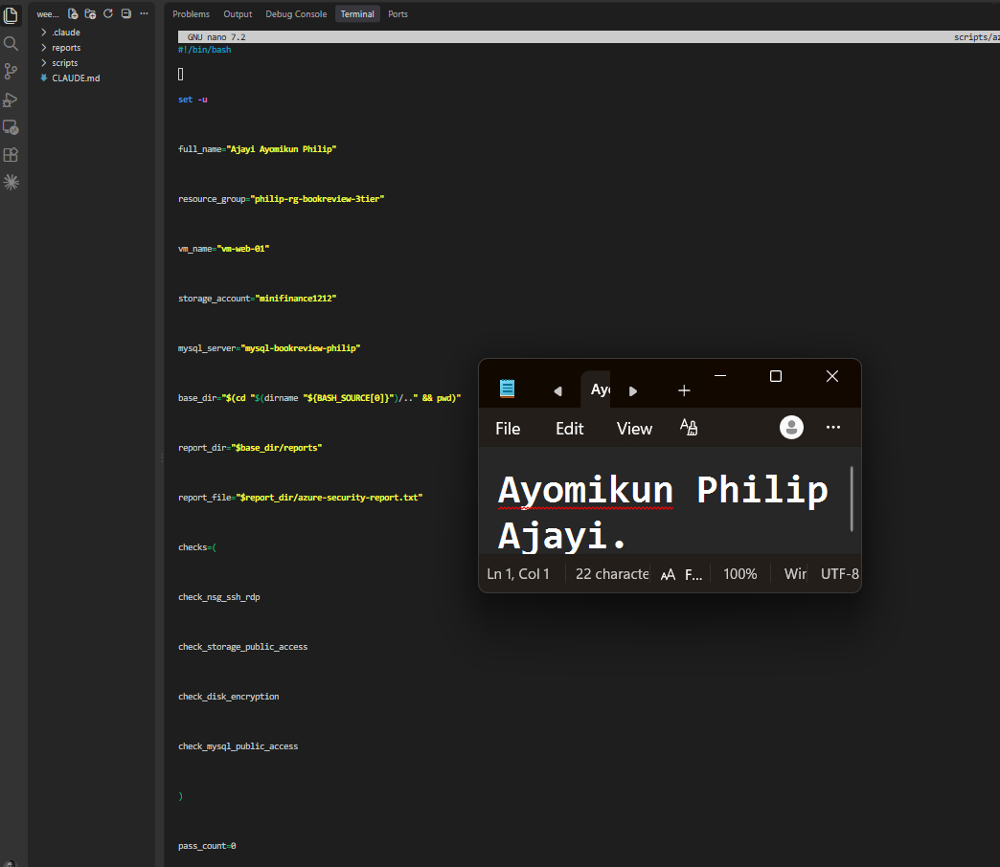

---

# Task 5 — Run the Script and Review the Baseline Report

## Goal

Run the script, capture its exit code immediately, review all four results, and save `reports/baseline-report.txt` before making any remediation.

## Evidence

#### Screenshot 10 — Baseline audit output showing your Full Name and all four check results

Add your screenshot here.

---

#### Screenshot 11 — Captured exit code and final report summary

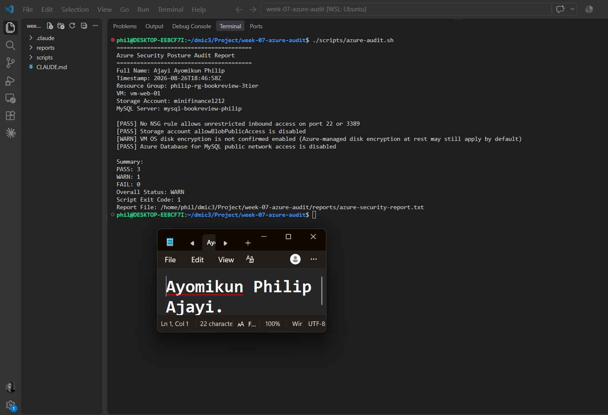

---

# Task 6 — Create and Run the /azure-audit Skill

## Goal

Create `.claude/skills/azure-audit/SKILL.md` with Bash, Read, and Grep permissions, without Write permission, and with manual invocation enabled. The Skill must run the audit, read the report, explain findings and their impact, and recommend remediation and verification commands without changing Azure resources.

## Evidence

#### Screenshot 7 — Your skill file's frontmatter showing `allowed-tools` without `Write`

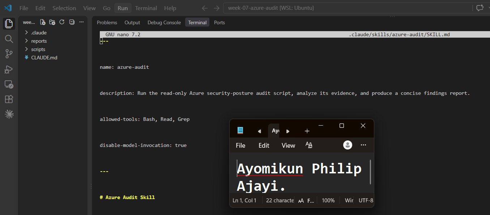

---

#### Screenshot 8 — `/azure-audit` output showing the baseline findings and Claude's explanation

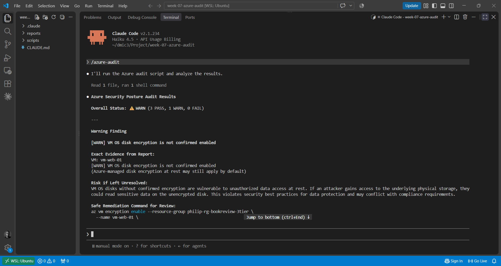   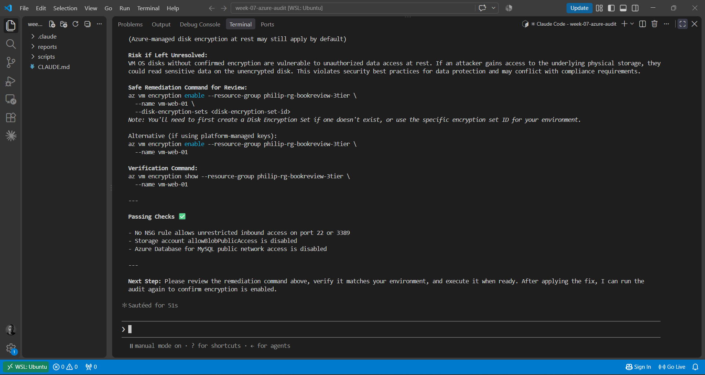

---

# Task 7 — Fix a Real Finding and Re-Verify

## Goal

Save the before-fix report, review a recommended remediation, execute the fix yourself, and rerun `/azure-audit` to confirm that the finding is resolved. Save the after-fix report.

If the baseline is clean, use only the controlled temporary SSH-rule exercise permitted in the assignment guidelines. Do not deliberately expose the database or Storage Account.

## Evidence

#### Screenshot 9 — Saved report showing the original finding before the fix

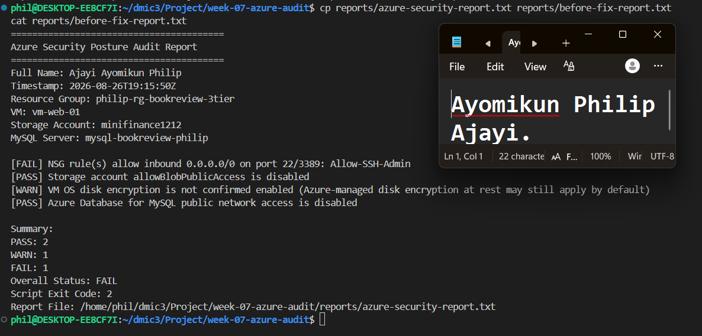

---

#### Screenshot 10 — Terminal output of the remediation command you ran yourself

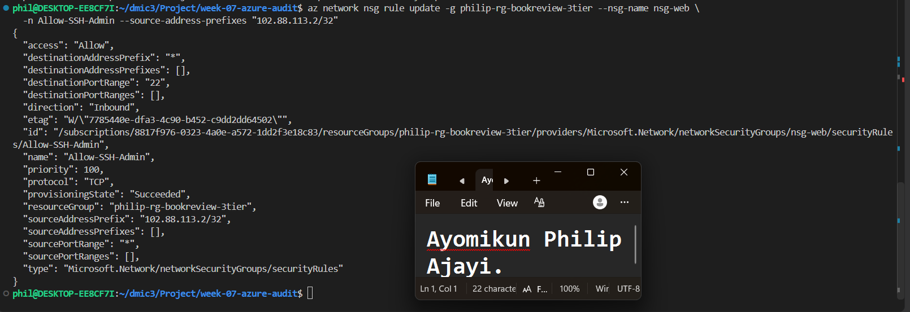

---

#### Screenshot 11 — Second `/azure-audit` run (or report) showing the finding resolved

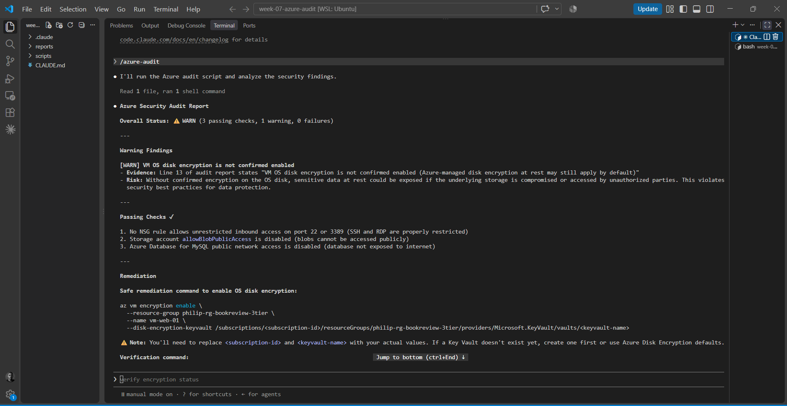

---

### Notes

Compare this assignment to the AWS audit you built in Week 6: which finding categories map to each other across the two clouds, and what stayed exactly the same about the workflow even though the `az`/`aws` commands are completely different?

Both audits ask the same four questions, just through different CLI verbs. Who can reach the network maps from AWS Security Group rules open on 22/3389 to Azure NSG rules open on 22/3389. Public data exposure maps from an S3 bucket's public access setting to a Storage Account's allowBlobPublicAccess. Encryption at rest maps from RDS storage encryption to VM OS disk encryption. And public database access maps from RDS's PubliclyAccessible flag to the MySQL Flexible Server's publicNetworkAccess setting.

What stayed identical across both is the workflow itself, not the commands. Both scripts followed the same Agentic Loop: gather evidence with read-only CLI calls, let Claude analyze and explain risk, let a human run any fix, then verify again with the same script. Both used only read-only verbs like list/show/describe, never create, update, or delete. Both CLAUDE.md files explicitly named the destructive commands to avoid rather than giving a vague warning, and both barred Claude from ever executing a remediation itself, even one it drafted. Both scripts used distinct exit codes for HEALTHY, WARN, and FAIL instead of a single pass/fail flag. And in both cases, planning the exact CLI commands with Claude before writing any Bash caught naming issues early, like the AWS RDS legacy server versus Azure's flexible-server.

So the cloud vendor and its command syntax changed completely, but the audit discipline, what gets checked, who's allowed to act, and how severity gets communicated, stayed exactly the same.

---

# Submission Instructions

- Include your Full Name and Screenshots **1–17** under the corresponding evidence headings.
- Answer every **Notes You Must Write** question.
- Include the required source files and saved reports through your GitHub repository/folder link.
- Include your published LinkedIn post URL.
- Ensure required outputs show your Full Name.
- Use multiple captures under an evidence heading where needed for readability.
- Do not expose subscription IDs, tenant IDs, client secrets, passwords, tokens, connection strings, private keys, or other credentials.
- After saving all evidence, remove temporary resources created specifically for this assignment as directed in the guidelines.
- Submit your work using the method specified in the assignment guidelines.

---

# Completion Checklist

- [ ] Task 1: Required resources confirmed and workspace created (Screenshots 1–2)
- [ ] Task 2: `CLAUDE.md` contains project context, workflow, safety rules, and output rules (Screenshot 3)
- [ ] Task 3: Four-check read-only plan completed before scripting (Screenshot 4)
- [ ] Task 4: Script created, syntax-checked, and executable (Screenshots 5–9)
- [ ] Task 5: Baseline report saved and exit code verified (Screenshots 10–11)
- [ ] Task 6: `/azure-audit` Skill created and run without executing remediation (Screenshots 12–13)
- [ ] Task 7: Finding documented, fixed manually, and verified as resolved (Screenshots 14–16)
- [ ] Baseline, before-fix, and after-fix reports saved
- [ ] All required written answers completed in my own words
- [ ] Required files and GitHub repository/folder URL included
- [ ] LinkedIn post published with the applicable credit note and tags (Screenshot 17)
- [ ] LinkedIn post URL included
- [ ] Full Name visible in required outputs
- [ ] No sensitive information exposed

---

## 📌 About DMI & CloudAdvisory

DevOps Micro Internship (DMI) is a project-based DevOps program run by Pravin Mishra (The CloudAdvisory) focused on real-world execution, systems thinking, and career readiness.

It helps learners build strong DevOps foundations with hands-on experience.

---

## 📌 Resources

- 🌐 DMI Official Website: https://dmi.pravinmishra.com?utm_source=github&utm_medium=readme  
- 🎓 University: https://university.pravinmishra.com?utm_source=github&utm_medium=readme  
- 💬 Discord Community: https://discord.pravinmishra.com?utm_source=github&utm_medium=readme  
- 📝 Blog: https://dmi.pravinmishra.com/blog?utm_source=github&utm_medium=readme  
- ▶️ YouTube Playlist: https://www.youtube.com/playlist?list=PLFeSNDtI4Cho  
- 🔗 Pravin Mishra (LinkedIn): https://www.linkedin.com/in/pravin-mishra-aws-trainer/  
- 🏢 CloudAdvisory (LinkedIn): https://www.linkedin.com/company/thecloudadvisory/

---

*This submission is part of DevOps Micro Internship (DMI) — Agentic AI Track.*
